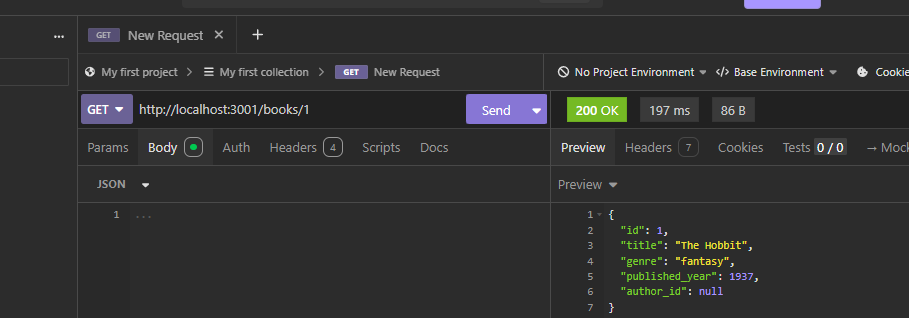
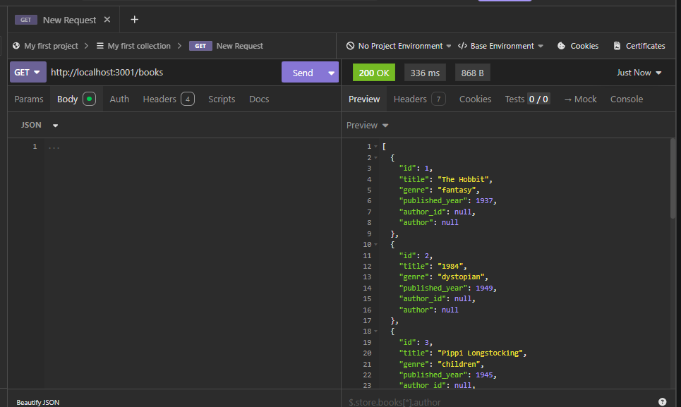
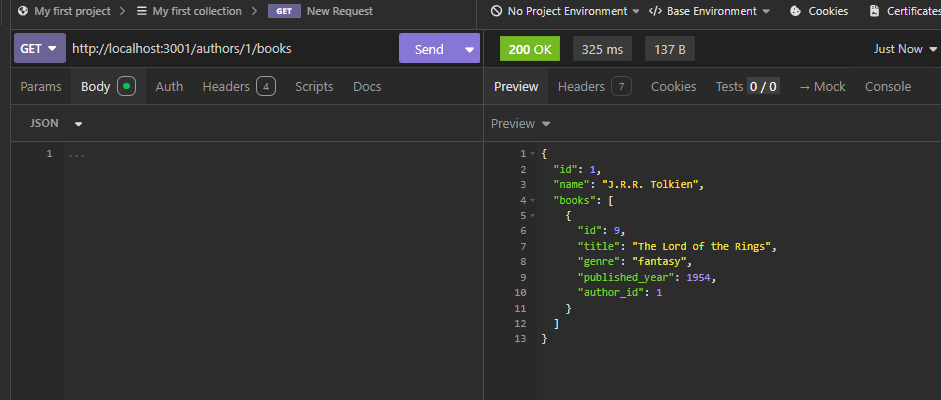
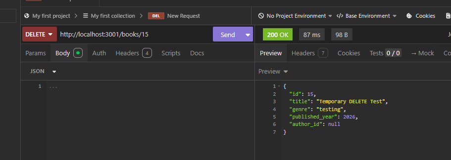
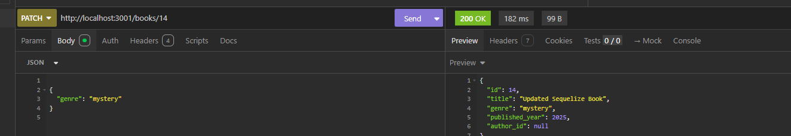
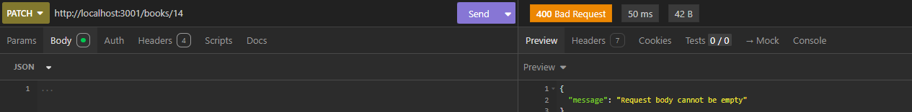
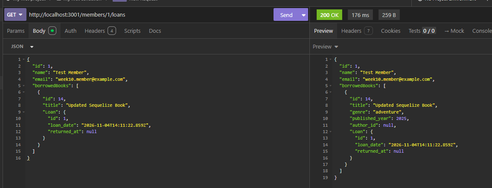
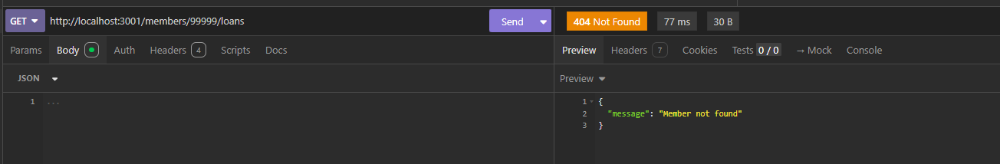
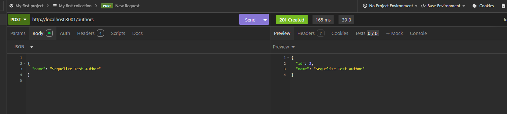

# Week 10 - Sequelize

This is my Week 10 backend assignment at Sundsgården.

In this assignment, I learned how to use Sequelize with PostgreSQL instead of writing SQL queries directly in my Express routes.

I used TypeScript for the whole project.

## Technologies

- TypeScript
- Node.js
- Express
- Sequelize
- PostgreSQL
- Docker
- pgAdmin
- Insomnia

## What I Did

- Connected Sequelize to PostgreSQL
- Created Sequelize models for Book, Author, Member and Loan
- Changed the book API to use Sequelize
- Added validation and error handling
- Created a one-to-many relationship between authors and books
- Created a many-to-many relationship between members and books using loans
- Tested the API in Insomnia
- Compared Sequelize queries with SQL queries

## Models

- Book - stores information about books
- Author - stores authors
- Member - stores library members
- Loan - stores which member borrowed a book and when

## API Routes

| Method | Route | Description |
|--------|-------|-------------|
| GET | /books | Get all books with authors |
| GET | /books/:id | Get one book |
| POST | /books | Create a book |
| PUT | /books/:id | Update a book |
| PATCH | /books/:id | Partially update a book |
| DELETE | /books/:id | Delete a book |
| GET | /authors | Get all authors |
| POST | /authors | Create an author |
| GET | /authors/:id/books | Get books by an author |
| POST | /loans | Create a loan |
| GET | /members/:id/loans | Get loans for a member |

## How to Run

Install dependencies:

```bash
npm install
```

Start PostgreSQL with Docker:

```bash
docker compose up -d
```

Create a `.env` file with the database settings:

```env
DB_HOST=localhost
DB_PORT=5432
DB_DATABASE=library
DB_USER=your_database_user
DB_PASSWORD=your_database_password
PORT=3001
```

Use your actual PostgreSQL username and password.

The database and the books and authors tables must already exist.

To create the Member and Loan tables, run:

```bash
npx tsx sync-loan-tables.ts
```

Start the server:

```bash
npm run dev
```

The API runs at:

http://localhost:3001

Check TypeScript:

```bash
npm run typecheck
```

## Testing

I used Insomnia to test the API routes and different HTTP status codes, including 200, 201, 400 and 404.

### Get book by ID



### Get books with authors



### Get author's books



### Delete book



### Update book with PATCH



### PATCH validation



### Get member loans



### Loan not found



### Create author



## Assignment Questions

My answers about ORM and Sequelize are in [ANSWERS.md](ANSWERS.md).

The generated Sequelize SQL, my own SQL queries and explanations are in [QUERIES.md](QUERIES.md).

## Git Branch

`week10/Sequelize`
 Author:
 Snezana Kraguejvac