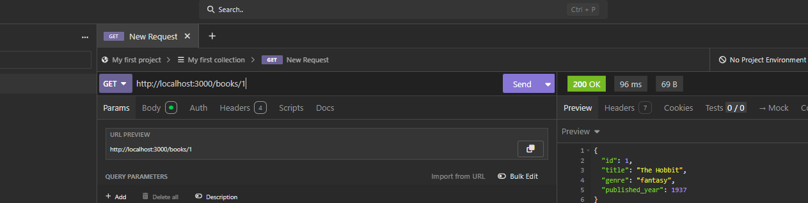
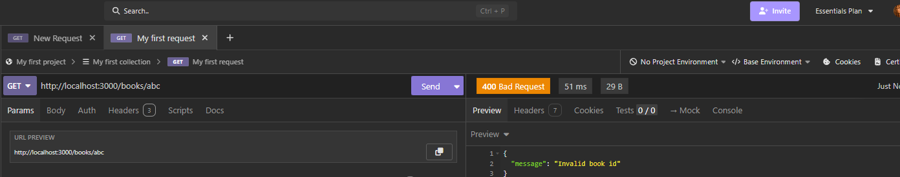
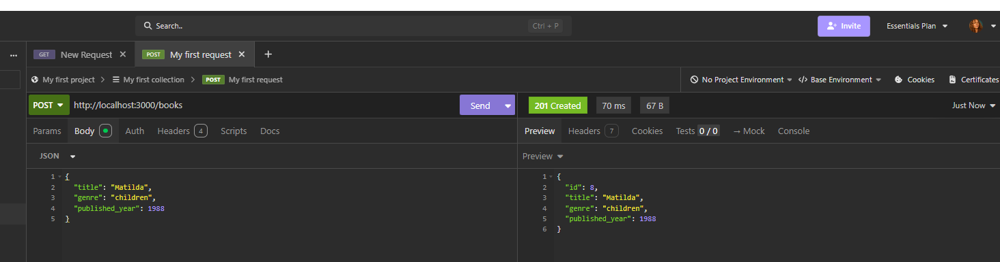
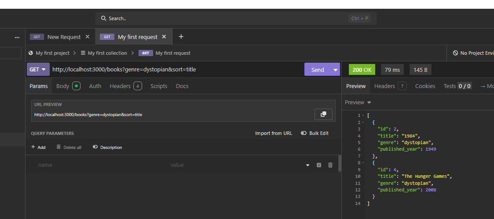
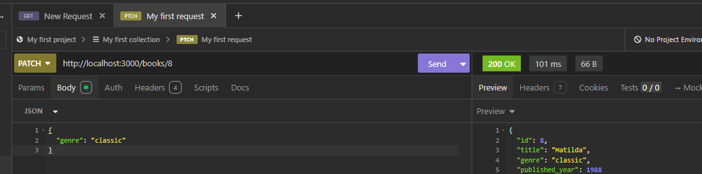
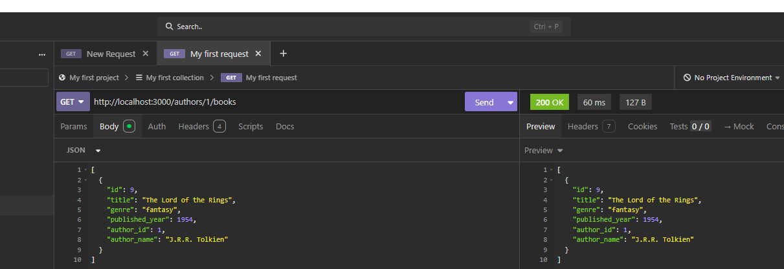
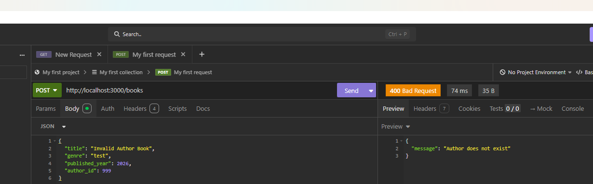

# Week 8 – Express + PostgreSQL

Backend homework using **TypeScript, Express, PostgreSQL, Docker, pgAdmin and Insomnia**.

I completed **Exercises 1–6**.

## Features

- CRUD API for books
- Get book by ID
- Validation and HTTP status codes
- Filtering and sorting
- PATCH partial updates
- Authors one-to-many relationship
- PostgreSQL JOINs
- Foreign key error handling

## Run

```bash
docker compose up -d
npm run dev
```

API runs at:

```text
http://localhost:3000
```

## Screenshots

### Get book by ID



### Validation



### Create book



### Filter and sort



### PATCH partial update



### Author JOIN



### Foreign key validation



## Completed Exercises

1. Get one book by ID
2. Status codes and validation
3. Clean up project structure
4. Filter and sort with query parameters
5. Partial updates with PATCH
6. Authors one-to-many relationship

## Branch

```text
week8/express-postgres
```

## Author

Snezana Kragujevac