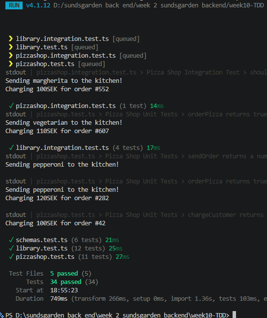

# Week 10 - Unit Tests, Integration Tests and Zod

This is my Week 10 Lesson 2 backend assignment at Sundsgården.

In this assignment, I practised testing with Vitest and validating data with Zod. I used TypeScript for all the code.

## What I did

- Exercise 1: Added a vegetarian pizza for 110 SEK
- Exercise 2: Tested chargeCustomer and fixed an error message
- Exercise 3: Tested Zod schemas
- Exercise 4: Created findBook to search the library catalogue
- Exercise 5: Created checkOutBook to generate loan IDs
- Exercise 6: Created registerLoan and borrowBook and tested how the functions work together

I completed Exercises 1-6. Exercises 7-9 were optional.

## Technologies

- TypeScript
- Node.js
- Vitest
- Zod
- Git and GitHub

## How to run

Install dependencies:

```bash
npm install
```

Run the tests:

```bash
npm test
```

Check TypeScript:

```bash
npm run typecheck
```

## Testing

I wrote unit tests and integration tests, following the red-green-refactor process.

All 34 tests passed across 5 test files.



## Assignment answers

My answers are in [ANSWERS.md](ANSWERS.md).

## Branch

week10/TDD
Snezana Krgujevac