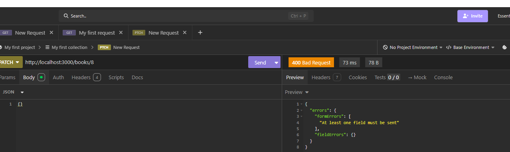
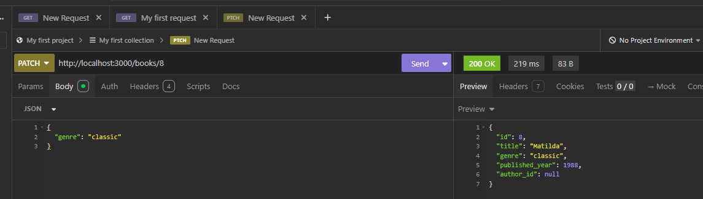
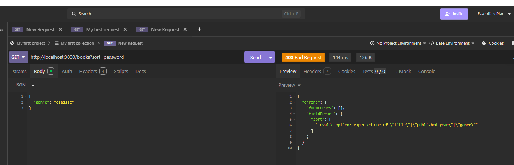
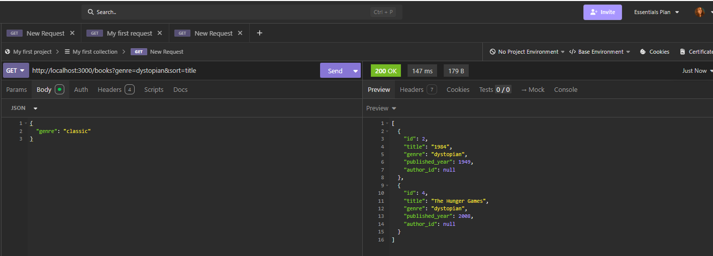

# Week 8 – Zod & ESLint

Backend homework at Sundsgården using **TypeScript, Express, PostgreSQL, Zod and ESLint**.

**Completed Exercises 1–6.**

## Features

- ESLint configuration and code checking
- Environment variable validation with Zod
- POST and PUT book validation
- URL parameter validation
- PATCH partial updates
- Query parameter validation and safe sorting

## Run Project

```bash
npm install
docker compose up -d
npm run dev
```

Check code:

```bash
npm run lint
npm run typecheck
```

## Testing Screenshots

### PATCH – Empty Body (400)



### PATCH – Successful Update (200)



### Invalid Sorting (400)



### Valid Filtering and Sorting (200)



## Git Branch

`week8/zod-eslint-express`

## Author

Snezana Kragujevac