# Week 9 – MongoDB Library API

For this assignment, I rebuilt a small library API with Express, MongoDB and Mongoose. I used Docker for the database and Insomnia to test the routes.

## Run locally

1. Run `npm install`.
2. Create `.env` using `.env.example` and set your own credentials.
3. Run `docker compose up -d`.
4. Run `npm run dev`.

The API runs at `http://localhost:3000`.

## Features

Book CRUD, schema validation, filtering and sorting. Books can also reference authors, and `populate()` returns the author details.

## Insomnia tests

View my screenshots

### Books and error handling

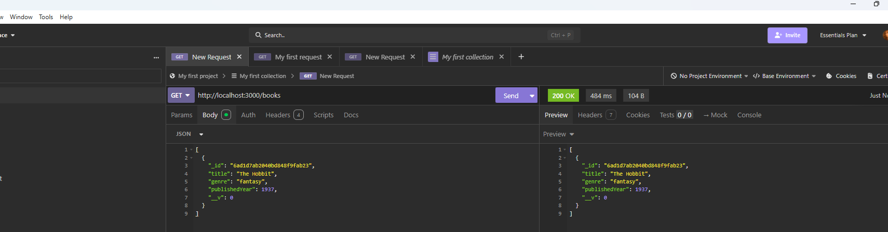
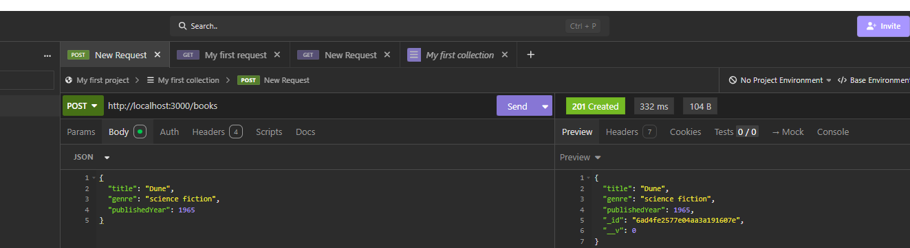
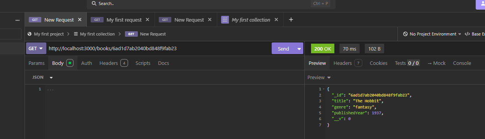
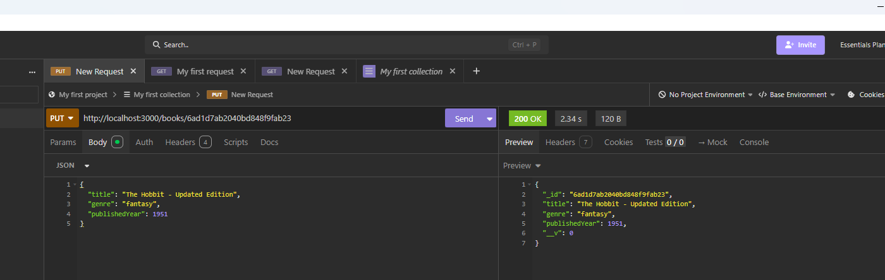
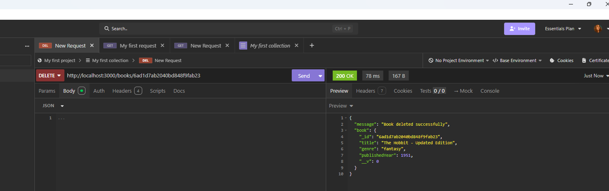
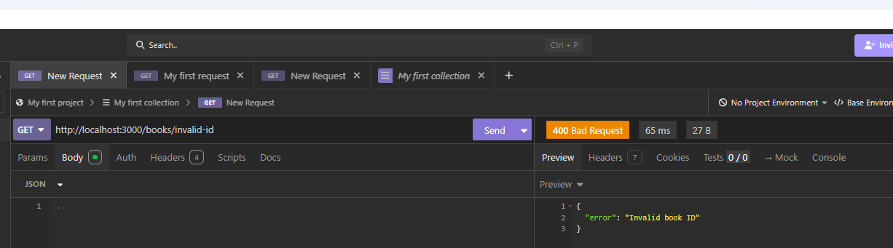
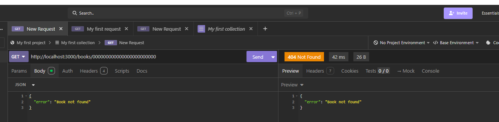

### Validation and queries

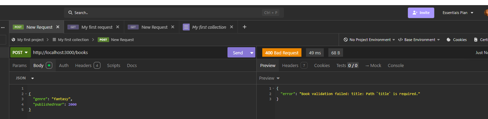
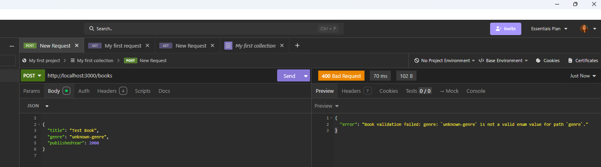
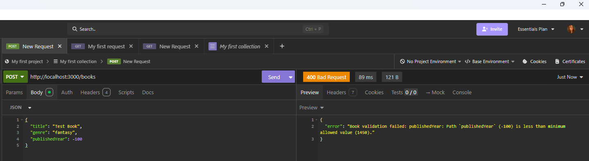
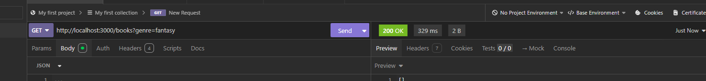
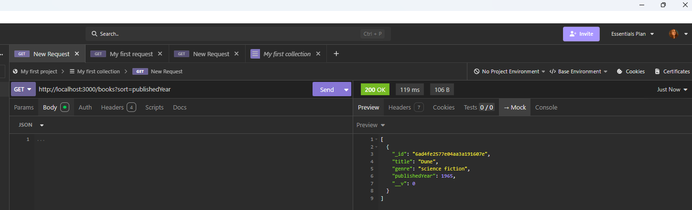
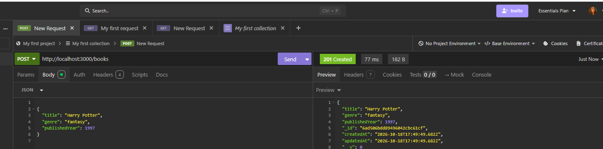

### Authors

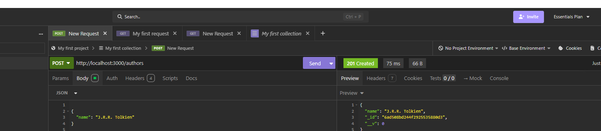
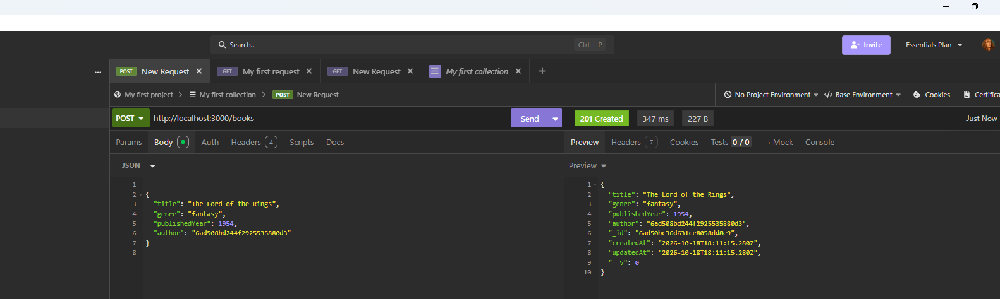
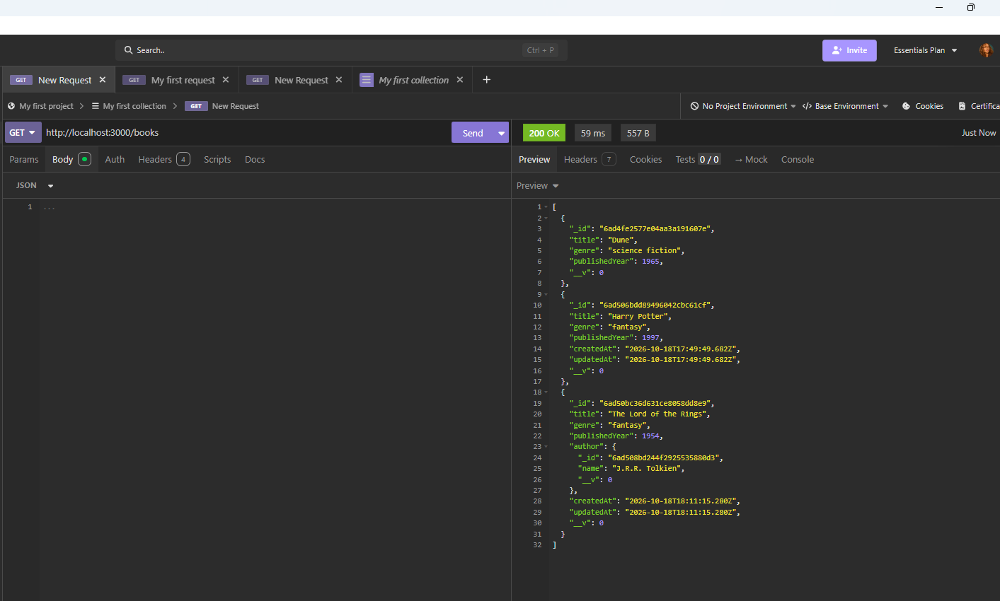
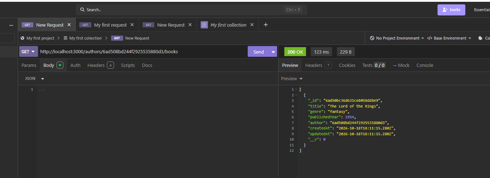
      

      created by: Snezana Kragujevac